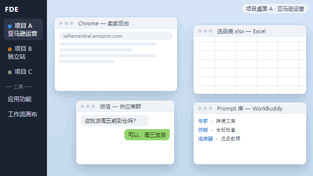
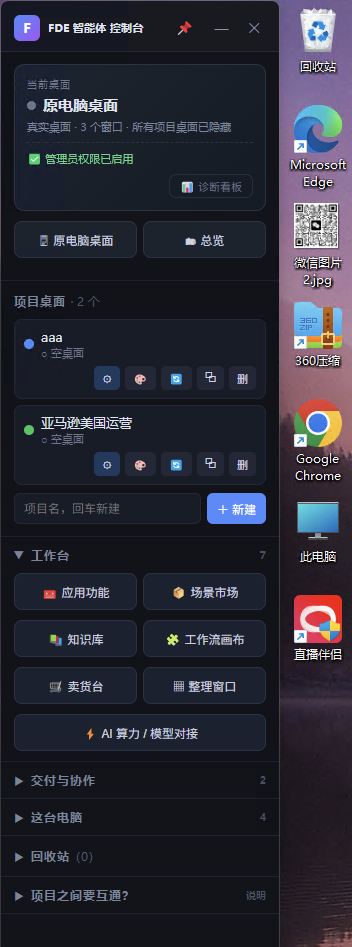

# FDE Manager（FDE 智能体 控制台）  可随意修改成为你自己的智能体控制台。

> **智能体给的是答案，不是工位。**
>
> 别的 "computer use agent" 让 AI 看屏幕、猜坐标、点鼠标；
> FDE 不截屏、不猜坐标——**直接调度你电脑上的原生窗口**，让 AI 干的活落在真软件里。

你已经有 WorkBuddy、Codex、Claude、豆包、Cursor 了。它们很会「想」。
但没人替你「摆窗口、串流程、管客户、搬电脑」。

FDE Manager 就是那个工位：**一台电脑 = N 张互不干扰的原生桌面**，一个客户 / 一条业务线一套工位，
模型随便换、流程可导出、数据全在本机。

[](LICENSE)
[](#平台支持)
[](https://www.electronjs.org/)
[](#测试)
[](#参与贡献)

**English**: The workspace layer for computer-use agents — native window isolation, per-project desktops, and a visual canvas that chains windows, scripts, knowledge and LLM calls into one runnable flow. No screenshots, no coordinate guessing: FDE drives real windows via OS APIs. Works with any OpenAI-compatible model.

📥 **直接下载安装包**：前往 [Releases](https://github.com/mayirenwu/fde-manager/releases) 页，Windows（NSIS 安装器 / 绿色便携版）、macOS（Intel + M 系列 dmg/zip）、Linux（AppImage / deb）都有三平台 CI 自动构建的产物。

<p align="center">
  
</p>
<p align="center"><sub>上：项目 A 的窗口整体收起、项目 B 原位归位+换壁纸 · 下：画布一条线跑完，结果落盘</sub></p>

[30 秒看懂](#30-秒看懂) · [你可能正卡在这里](#你可能正卡在这里) · [五个卖点](#五个让人回不去的地方) · [真实的一天](#真实的一天两个场景) · [对比](#和常见的几种做法比) · [同类项目](#同类开源项目怎么比) · [它不是什么](#它不是什么) · [快速开始](#快速开始)

## 30 秒看懂

| 你得到的 | 具体是什么 |
| --- | --- |
| **一张桌面** | 左侧常驻侧栏 + 右侧**真桌面**：真的 Chrome、真的 Excel、真的微信，不是模拟器 |
| **N 套工位** | 每个项目一组窗口。切走时窗口被真正隐藏，切回原位原样恢复 + 换壁纸 |
| **一条流程** | 画布上把 窗口 / 网页 / 文件 / 脚本 / 知识库 / AI / 生成 连成一条线，一键跑完 |
| **一个可改的软件** | 专家、技能、提示词、脚本、画布全是可编辑资产——用你最顺手的智能体改 |
| **一次搬走** | 换电脑 = 一个快照文件 / 一个绿色便携包，不是重新配一遍 |

**它不替你想，它让「想到的」真正跑起来。**

## 你可能正卡在这里

你已经在用智能体了，但一到「真的把事情跑起来」，问题全在屏幕之外：

- 智能体回了你一段漂亮的话，**然后呢**？十个窗口还得自己摆、七个后台还得自己登、每周固定那几步还得自己点；
- 每个工具都很聪明，**但谁也不认识谁**：WorkBuddy 里的专家、Codex 写的脚本、知识库里的合同、浏览器里的后台，散在四个地方；
- 想让它干活，先得把整本资料灌进上下文，**token 烧得心疼**，还经常答偏；
- 一台电脑同时跑三条业务线，A 客户的报价绝不能出现在 B 客户的屏幕上，**可窗口全挤在一起**；
- 换台电脑 = 重新教一遍：路径变了、窗口没了、密钥忘了、流程断在第三步。

一句话：**智能体给的是答案，不是工位。**

FDE Manager 补的就是这一块——**智能体负责「想」，它负责「摆、管、串、搬」。**

## 它到底解决了什么

```
以前：想  →  复制一段话  →  自己去开窗口  →  自己点二十步  →  下次重来
现在：想  →  双击项目    →  窗口就位、流程跑完  →  结果落在文件夹里
```

- **从「对话」到「工位」**：会话是一次性的，工位是每天都在的；
- **从「一个人的记忆」到「一条能被审阅的流程」**：画布可导出、可交接、可复盘；
- **从「绑死一个模型」到「换模型不换流程」**：任何 OpenAI 兼容接口都能接。

## 它是一张「装得下智能体成果」的桌面

左侧 280px 常驻侧栏（系统级 AppBar，不是悬浮小窗），右侧是你的**原生桌面**：真的浏览器、真的 Excel、真的微信、真的交易软件，一个都不是模拟的。

```
┌──────────┬───────────────────────────────────────────────┐
│ FDE 侧栏 │  项目桌面 A：亚马逊运营                         │
│          │   Chrome(后台) · Excel(选品表) · 微信(供应商)  │
│ 项目 A ← │   ── 一键切到项目 B ──                         │
│ 项目 B   │   项目桌面 B：独立站                           │
│ 项目 C   │   Chrome(另一套账号) · 飞书 · VS Code          │
│          │   A 的窗口全部收起，B 的原位原样恢复 + 换壁纸    │
└──────────┴───────────────────────────────────────────────┘
```

**一台电脑 = N 张互不干扰的桌面。** 不是虚拟机的重量级隔离，是**原生窗口级隔离**：切走时窗口真的被隐藏（不是最小化），切回来位置、大小、层叠顺序都不变。A 客户的报价，永远不会出现在 B 客户的屏幕上。

对做交付的人，这句话的分量是：**你可以在一台电脑上同时接三个客户，而他们互不知情。**

## 五个让人回不去的地方

### 1. 用你最顺手的智能体改，改完就是「你的软件」

FDE 不绑定任何一家模型或智能体，它的业务能力全是**可编辑的资产**：

- 「应用功能」里的专家 / 技能 / 连接器 / 资料库，可以直接从 WorkBuddy、Codex 导入，也能自己新建、复制、导出；
- 「工作流画布」是一张可导出的 JSON：节点连什么、提示词写什么、脚本怎么跑，你和你的智能体都能改；
- 内置「AI 构建器」能把一句需求变成可运行的脚本、直接落到画布上跑。

所以真实用法是：**让 WorkBuddy / Codex / 豆包帮你写业务逻辑，FDE 负责把它装进一个能天天用的工位里。** 定制出来的不是一段聊天记录，是一个双击就开的软件。

模型也一样：任何 OpenAI 兼容接口都能接——DeepSeek、豆包、Kimi、通义、自建 vLLM、你自己的中转站。**模型可以换，你的流程不用重做。**

### 2. 算力花在刀刃上，不花在搬运上

- **本地知识库先算**：资料在本地分词、打分、检索，只把命中的那几个片段（每条 ≤1800 字）喂给模型，而不是把整本手册塞进上下文；
- **脚本优先，模型兜底**：固定步骤走脚本节点（稳、快、不花钱），只有真需要判断的那一步才调模型；
- **上下文编排一次，长期复用**：项目材料、窗口、网页、脚本、AI 节点在画布上连好，之后一键触发，不用每次重新「喂背景」。

同样的活，「整库进 prompt」和「只进命中片段」，喂进去的 token 往往能少一个数量级。

**固定的事让脚本干，判断的事让模型干——这是省钱和稳定的同一个答案。**

### 3. 脚本 + AI 双引擎，能落地的才叫流程

画布有十种节点：项目 / 窗口 / 网页 / 脚本 / 文件 / 文件夹 / 笔记 / AI / 分组 / 生成（图·视频·音频）。节点可以单独试跑、单独看输出、单独调参数。

固定动作交给脚本，判断和创作交给模型，两边在同一条线上串起来——**这条线可以被导出、被审阅、被交接，而不是活在某个人的脑子里。**

### 4. 换电脑不用重来

「环境 / 迁移」里三件套：

- **环境快照**：一键导出/导入项目、画布、应用资产、配置（默认剥离密钥）；
- **绿色便携版**：整个工作台打成一个可带走的包，插到别的电脑上就能开；
- **数据目录重定向**：换盘、换路径后一键改写，不用手工改 JSON。

**从一台机器搬到另一台，是搬一个文件，不是重新配一遍。**

### 5. 交付得出去，才算真的做完

给客户做智能体的人都知道，难的不是「跑通」，是「交接」：谁确认过、改了什么、边界在哪、责任怎么划。信任中心把这些做成台账——确认记录、验收材料、干系人、数据安全说明、案例卡、条款，双方看同一份。

这也是 FDE 真正的护城河：**别人给你一个工具，你交出去一个可验收的系统。**

## 真实的一天（两个场景）

**场景 A｜一个人做跨境电商**

> 早上开机 → 侧栏点「亚马逊运营」→ Chrome 后台、选品表、供应商微信同时归位，壁纸也换了 → 画布点「跑一遍」：脚本抓竞品价、知识库查合规规则、AI 写五条文案、生成节点出主图 → 结果落在 `发布包/今天/`。
> 下午切「独立站」→ 亚马逊那套窗口整体收起，客户看不到你手里还有别的事。

**场景 B｜做 AI 交付的顾问**

> 给客户 A 建一张桌面：他的后台、他的表格、他的流程、他的模型密钥。
> 交付时导出一个快照 + 一套场景包，客户装到自己的电脑上，双击就开，界面和你演示的一模一样。
> 第二天给客户 B 做，从 A 的场景包复制一份改三处——**不用从零开始，也不会串台。**

## 和常见的几种做法比

|  | 纯聊天智能体 | RPA 工具 | 虚拟机 / 云桌面 | **FDE Manager** |
| --- | --- | --- | --- | --- |
| 用你真机上的软件 | ❌ 只能给建议 | ⚠️ 要逐个录制 | ✅ 但换成另一套系统 | ✅ 原生窗口，原样用 |
| 切任务 | 换个对话，窗口还得自己摆 | 只能跑固定流程 | 切虚拟机，资源翻倍 | 一键切桌面，窗口原位恢复 |
| 怎么定制 | 改提示词 | 改流程，改起来难 | 改镜像，重装环境 | 用任意智能体改资产 / 画布 |
| 换电脑 | 重新聊一遍 | 重新配一遍 | 重装镜像 | 一个快照 / 便携包 |
| 数据在哪 | 厂商云 | 本机 | 云或本机 | **本机**（含密钥） |
| 钱花在哪 | 按 token | 授权费 | 一台机器一份系统 | MIT 免费，只付你自己的模型钱 |

## 同类开源项目怎么比

这个赛道正在爆发（OpenInterpreter 68.9k★、Skyvern 23.5k★、Agent-S 13k★、self-operating-computer 10.3k★、microsoft/UFO 10.2k★），但各家管的是不同的层：

| 项目 | 管哪一层 | 和 FDE 的关系 |
| --- | --- | --- |
| Skyvern / Agent-S / UFO / self-operating-computer | **AI 看屏幕**：截图 → 视觉模型 → 模拟点击鼠标键盘 | 互为上下游：它们负责「操作」，FDE 负责「工位」——窗口怎么摆、任务怎么切、结果落在哪。AI 点错一步不会毁掉你的桌面布局，因为布局归 FDE 管 |
| OpenInterpreter | **本地跑代码**：让模型在本机执行命令 | 同上，FDE 给它的执行结果一个能天天用的家 |
| n8n / Dify | **服务端工作流**：跑在 Docker / 云上，操作 API 和数据 | 它们跑不到你桌面上——最后一步「在客户电脑上打开 ERP 把结果填进去」，正好是 FDE 的地盘 |
| Dify-Sandbox | **代码沙箱**：Seccomp 隔离不可信代码 | 解决「代码敢不敢跑」，不解决「跑完谁来干活」；做交付把桌面分给团队用时会需要它这类隔离 |
| PowerToys / OpenRPA | **窗口管理 / RPA**：无 AI 或录制回放 | PowerToys 管单个窗口的布局，FDE 管「一个项目一整套窗口」的聚散；OpenRPA 靠录制坐标，FDE 靠真实窗口句柄 + 可读的画布 |

**一句话：这个赛道人人都教 AI「怎么干活」，只有 FDE 先给 AI 一张「干活的桌子」。**

## 它不是什么

说清楚边界，比吹功能更值钱：

- **不是又一个聊天框**——它不做模型，它做模型干活的地方；
- **不是 RPA**——不靠录制坐标，靠真实窗口和脚本；
- **不是虚拟机**——不复制系统，只调度你已有的原生窗口；
- **不是云服务**——数据、密钥、流程都在你本机，断网也能用知识库和脚本；
- **不是「一键全自动」的魔法**——它把「二十步手工」变成「一条线」，但那条线得你先画一次。

## 谁该用

| 你是 | 你会拿它做什么 |
| --- | --- |
| 一个人干一条业务线的 | 选品 → 文案 → 合规 → 发布 → 复盘 串成一条链，早上开机自动就位 |
| 做 AI 交付 / FDE / 外包的 | 一个客户一张桌面、一套场景包，交付即安装，换人接手不用讲半小时 |
| 公司里「那个懂电脑的」 | 给运营、财务、客服各配一张桌面，互不串台；出问题有诊断看板 |
| 想给团队搭智能体底座的公司 | 模型可换、提示词可改、流程可导、数据在本地，不被任何厂商锁死 |

## 功能一览

| 模块 | 做什么 |
| --- | --- |
| 项目桌面 | 按项目隔离真实窗口：切换桌面 = 隐藏/显示窗口 + 换壁纸；可选管理员权限，隔离「以管理员运行」的程序 |
| 应用功能 | 专家 / 技能 / 连接器 / 资料库，一键变画布节点；从 WorkBuddy、Codex 下载，也能自己建、导入 |
| 模型设置 | 填一把 API 密钥（默认接 [ai.my10086.cn](https://ai.my10086.cn/api/console/keys)），画布 AI 节点直接跑文本/图片/视频/音频模型；密钥只在本地，交付包自动剥离 |
| 知识库 | 把现有文件夹一键变成可检索、可问答的资料库（本地分词 + 打分，**不联网也能用**），支持拖拽导入 |
| 工作流画布 | 项目 / 窗口 / 网页 / 脚本 / 资料 / AI 节点自由连线，一键运行整条流程 |
| 卖货台 | 选品打分 → 文案 → 合规检查 → 发布复盘一条链，发布包落本地文件夹 |
| 场景市场 | 跨境 / 外贸 / 盯盘等现成行业工作台，一键套用 |
| 信任中心 | 交付双方共用的台面：确认台账、验收、干系人、安全说明、案例、条款 |
| 环境/迁移 | 环境体检、导出/导入快照、改数据目录、一键打绿色便携版 |

## 平台支持

| 平台 | 状态 | 说明 |
| --- | --- | --- |
| Windows 10/11 | ✅ 完整 | 窗口隔离 / AppBar / 壁纸 / 自启 / 托盘全部可用；首次会请求管理员权限（用于隔离管理员程序） |
| macOS (Intel & Apple M) | ✅ 可用 | 窗口管理走 JXA（System Events）；无 AppBar / 壁纸切换，安装后需在「系统设置 → 隐私与安全性」给 FDE 授权「辅助功能」 |
| Linux (X11) | ✅ 可用 | 窗口管理走 xdotool + wmctrl（需要自行安装）；Wayland 会话下窗口隔离不可用 |

## 快速开始

```bash
# 依赖：Node.js 18+（打安装包另需各平台打包工具，见下）
npm install
npm start          # 直接跑源码
npm test           # 一键跑 17 个单测文件
```

### 打安装包

```bash
npm run dist:win    # Windows: NSIS 安装器 + 便携版（x64）
npm run dist:mac    # macOS: dmg + zip（x64 + arm64）
npm run dist:linux  # Linux: AppImage + deb（x64）
```

也可以直接推一个 `v*` 标签，GitHub Actions 会在三个系统上各出一份安装包（见 `.github/workflows/build.yml`），到 Actions 页面的 Artifacts 下载。

## 权限与隐私（请务必读这一节）

这是一款会**管理你其它软件窗口**的工具，杀毒软件/系统审阅对它敏感是正常的。它的边界如下：

- **窗口枚举与隐藏**：为了按项目隔离窗口，FDE 会枚举你桌面上所有顶层窗口的句柄、标题、进程名。这些信息只存在本机数据文件里，用于记住「哪个窗口属于哪个项目」，**不上传任何服务器**。
- **API 密钥**：模型设置里填的密钥保存在本机数据目录，只在你发起模型调用时发给**你自己配置的模型接口**。导出交付包/环境快照时默认剥离密钥（源码里可搜 `sanitizeDelivery`）。
- **截屏**：仅在你主动点「截屏」按钮时抓一张图，用于给 AI 看当前画面，图不落盘不外传（内存直传模型接口）。
- **管理员权限（仅 Windows，可选）**：Windows 不允许普通权限进程隐藏管理员权限的窗口。如果你的项目里有以管理员运行的软件（交易软件等），需要提权一次；不授权则这些窗口无法被隔离，其它功能不受影响。
- **开机自启 / 壁纸切换**：全部可在「这台电脑」分组里关掉。

所有数据默认存放在 `app.getPath('userData')`（Windows 约 `%APPDATA%/fde-manager/`），删掉目录即完全重置。

## 配置模型渠道

默认渠道是 `ai.my10086.cn`（示例文件见 [`fde-delivery.example.json`](fde-delivery.example.json)）。想接其它 OpenAI 协议兼容的服务，在「应用功能 → 模型设置」里改接口地址并填自己的密钥即可；也可以改根目录的 `fde-delivery.json` 预置你自己的渠道（`shareKey: false` 表示只预置地址不预置密钥）。

## 目录结构（节选）

```
main.js            主进程：窗口、AppBar、桌面切换、IPC
platform.js        平台能力矩阵（win/mac/linux/none 一处声明）
wmp.js             窗口管理适配层（ps1 / JXA / xdotool 三实现）
ai.js / models.js  模型调用与目录整形（纯函数，可单测）
kb.js / apps.js    知识库 / 应用功能
urlopen.js         打开网页的意图匹配与认领（防「闪一下就没了」）
panel.html         左侧常驻面板
project.html       项目控制面板
scripts/           测试、检查、截图、打包辅助脚本
.github/workflows  三平台打包 CI
docs/              跨平台说明
```

## 测试

```bash
npm test                       # 17 个纯 Node 单测文件（平台/窗口/模型/知识库/画布/卖货台…）
npm run smoke                  # 发布门禁：9 个窗口挨个真开一遍，查白屏/脚本错误/空页面
node scripts/check-syntax.js   # 主进程 + 所有页面内联脚本语法
node scripts/check-ipc.js      # preload 通道 ↔ 主进程 handler 一一配对（166 个）
node scripts/check-platform.js # 审计所有 Win32 调用是否都有平台守卫
```

`npm run smoke` 是发布前最该跑的一条：它会真的打开面板、项目面板、应用功能、场景市场、
知识库、卖货台、环境迁移、信任中心、总览画布这 9 个窗口，确认每个都**有内容、无报错**，
并把截图存到临时目录。新增窗口或改页面后跑一次，比人眼逐个点开可靠。

`scripts/` 下另有 30 多个检查脚本（280px 面板布局、密钥安全、打开网页兜底、卖货台链路、知识库 UI 等）。
其中依赖 `electron` 运行时的需要真实显示环境，例如：

```bash
npx electron scripts/check-kb-apps.js     # 沙箱/CI 里若设了 ELECTRON_RUN_AS_NODE 需先 unset
```

真机排障探针：`scripts/probe-openurl.js`、`scripts/probe-spawn.js`（用 `--exe=` 指定要试的浏览器）。

## 已知限制

- 安装包未做代码签名：Windows 会弹 SmartScreen 警告（「更多信息 → 仍要运行」），macOS 未公证（右键 → 打开，或在系统设置里放行）。签不签名由你自己的开发者账号决定，欢迎 fork 后自行签名。
- 「打开网页」依赖系统默认浏览器；个别套壳浏览器（如 360 安全浏览器）spawn 起不来时，FDE 会自动换一个装着的浏览器，再不行用内置窗口兜底。
- Linux 仅支持 X11；Wayland 下窗口枚举/隐藏不工作（其它功能不受影响）。
- macOS / Linux 的窗口管理是按平台单独实现的（JXA / xdotool）并有单测与构建覆盖，但作者日常主要在 Windows 上使用。这两个平台上遇到问题，欢迎提 issue 带诊断看板的日志，修得会很快。

## FAQ

**会不会被当成木马？**
它确实会枚举/隐藏窗口、可选提权、可选自启——这些能力本身敏感。所以源码全开、行为边界写在上面的「权限与隐私」里、密钥不上传、数据可一键清空。杀软误报请提 issue 带上厂商与版本号。

**必须联网才能用吗？**
不。知识库检索、脚本、窗口隔离都是本地的；只有调模型那一步需要网络（你也可以接本地 Ollama / vLLM）。

**换模型要重做流程吗？**
不用。画布节点引用的是「模型能力」而不是具体型号，换渠道后在「模型设置」里重选即可。

**会截屏吗？和 Skyvern 这类"看屏幕"的智能体什么区别？**
FDE 默认不截屏。看屏幕的智能体（截图→视觉模型→模拟鼠标键盘）每一步都花 token、都可能是 80% 的正确率；FDE 直接用系统 API 管真实窗口——切换、归位、隐藏是确定性的，一步都不会错，也不花一分钱。两者可以搭配：让 Skyvern/UFO 负责单步操作，FDE 负责整个工位的秩序。

**和 Dify 什么关系？**
Dify（含 Dify-Sandbox）解决 AI 应用怎么跑：工作流、RAG、沙箱。FDE 解决跑完之后的事：窗口就位、流程落地、交付交接。你完全可以在 Dify 里跑模型链，把 FDE 当成它的"桌面执行器"。

**Apple M 系列、Intel Mac、Linux 都能用吗？**
能，三平台各有 CI 构建产物；窗口管理按平台分别实现（PowerShell / JXA / xdotool）。

**能团队一起用吗？**
当前是「一人一机一套工位」的设计，团队协作通过**导出场景包 / 快照**交接；多人共享同一套数据目录不在范围内。

## 路线图（欢迎在 issue 里催更/插队）

  - [x] README 顶部 GIF 演示（模拟界面：切桌面 + 画布跑一条线，docs/demo.gif，scripts/make-demo-gif.js 可再生）
- [ ] 英文版 README（README.en.md），面向海外 computer-use 社区
- [ ] v7.26.3 提成正式 Release，安装包直链下载
- [ ] 开源证书签名（SignPath / Apple Developer ID），去掉 SmartScreen / Gatekeeper 拦截
- [ ] 脚本节点可选沙箱化（参考 Dify-Sandbox 的 Seccomp 思路），为「把桌面分给团队用」铺路
- [ ] 场景市场扩充：欢迎提交你的行业工作台（n8n 模板库模式）

## 参与贡献

Issue / PR 都欢迎。改完代码请跑 `npm test` 和 `node scripts/check-syntax.js`，新增窗口管理相关的改动请一并跑对应平台的真机验证（虚拟机里窗口行为差异很大）。

如果这个项目帮你把「二十步手工」变成「一条线」，**给个 ⭐ 是最实在的支持**——它会让更多做智能体交付的人少走一遍你走过的弯路。

## 许可

[MIT](LICENSE) · 随便用，随便改，商用也行；只保留版权声明。

## 它长这样

左侧一条 280px 常驻侧栏，就是全部操作入口——右边仍是你的真实桌面。最重要的是，你可自由修改成你想要的：


